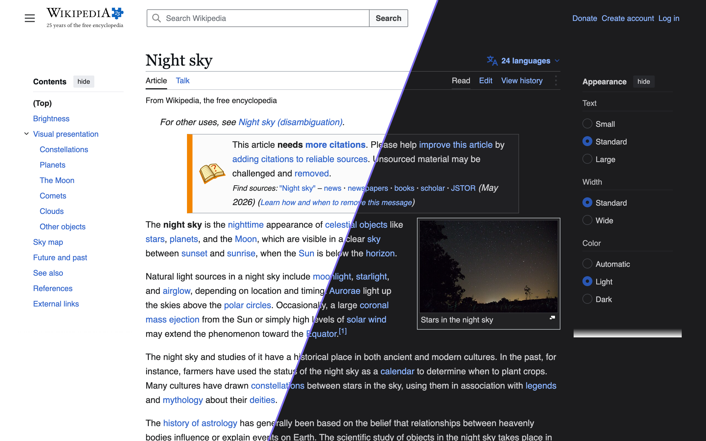
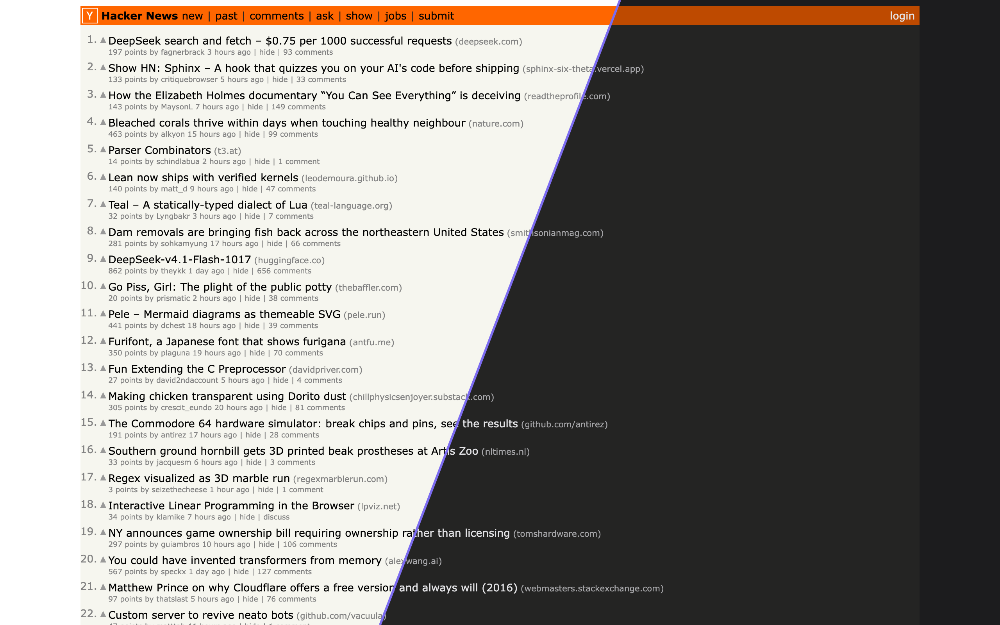
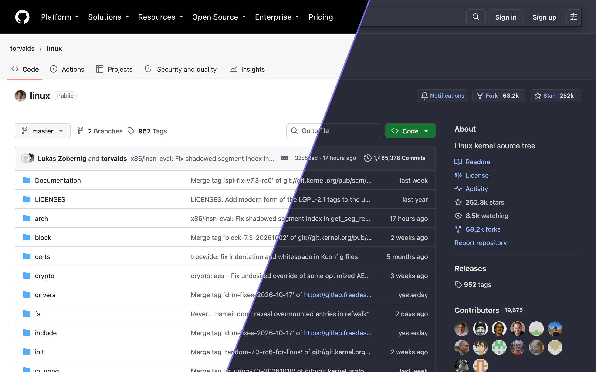
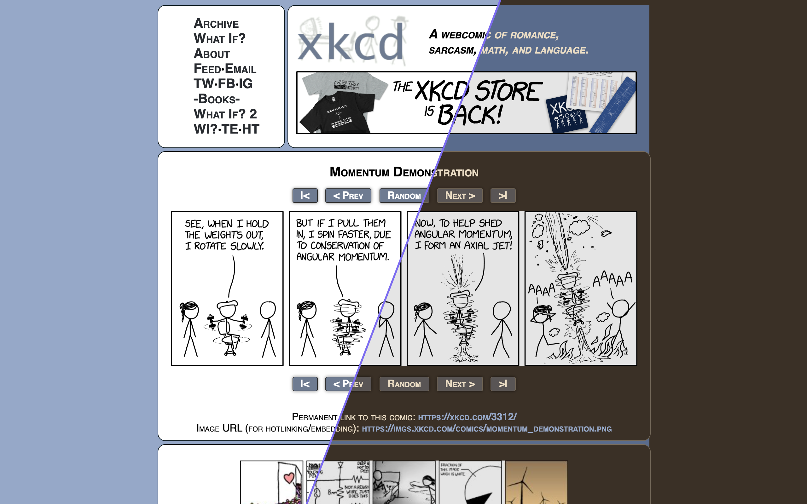

<h1 align="center">Nyx</h1>

<strong>Dark mode for websites that don't have one.</strong> 
A dark mode extension for Safari on iPhone, iPad and Mac. It also runs in Chrome, Edge and Firefox. 
<a href="https://azimi.me/nyx/">Website</a> · <a href="https://azimi.me/nyx/support/">Support</a> · <a href="https://azimi.me/nyx/privacy/">Privacy</a>

  
  
  

Nyx doesn't invert pages. It reads each site's stylesheets and writes a dark version of them, so blue links stay blue and a red header stays red. Sites that already have a dark mode are left alone.

You can have Nyx follow the system's Dark Mode or a schedule, keep it on or off, and set any website differently. It comes with 26 themes, from plain Dark and Sepia to Dracula, Nord and Solarized, and you can make your own and share them as links. On Apple devices, settings sync through iCloud, and Nyx works with Shortcuts, Focus Filters and Control Center.

Nyx collects no data. The only network requests it makes are for stylesheets and images the page already loads, so it can read their colors.

## Install

- **Safari:** the App Store version isn't out yet. For now, [build it with Xcode](DEVELOPMENT.md#safari).
- **Chrome, Edge, Firefox:** download the zip from the [latest release](https://github.com/mohsen1/nyx/releases/latest), or [build and load it yourself](DEVELOPMENT.md#chrome-edge-firefox). It isn't on the Chrome Web Store yet.

## Contributing

See [DEVELOPMENT.md](DEVELOPMENT.md).

## License

MIT. See [LICENSE](LICENSE).
