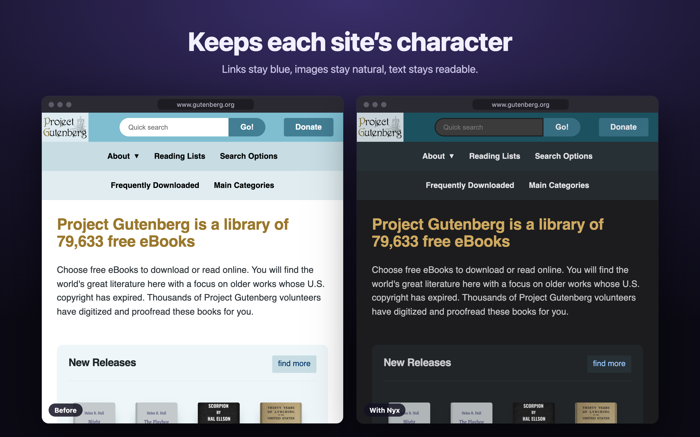
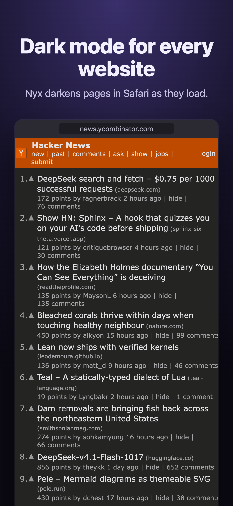
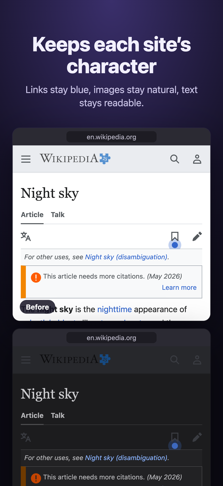
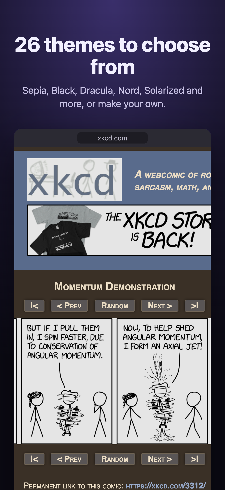
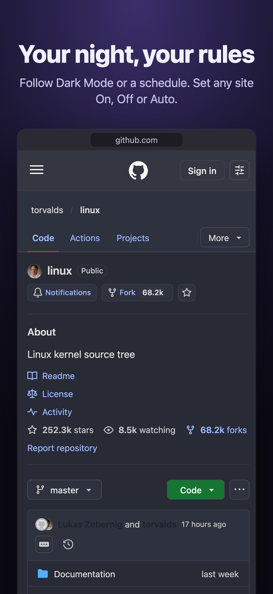

<h1 align="center">Nyx</h1>

<strong>Dark mode for every website.</strong> 
A Safari extension for iPhone, iPad and Mac. Also runs in Chrome and Firefox. 
<a href="https://azimi.me/nyx/">Website</a> · <a href="https://azimi.me/nyx/support/">Support</a> · <a href="https://azimi.me/nyx/privacy/">Privacy</a>

  
  
  
  

Nyx doesn't invert pages. It builds a dark style from each site's own colors, so links stay blue, brands stay recognizable and text stays readable.

- **Auto, On or Off.** Follow system Dark Mode or a schedule, or set each website on its own.
- **26 themes.** Dark, Black, Sepia, Dracula, Nord, Solarized and more, or make your own.
- **Respects built-in dark modes.** Sites that already have one are left alone.
- **Works across your devices.** iCloud sync, Shortcuts, Focus Filter and a Control Center control.
- **Private.** No data collection, no network requests of its own.

## Install

- **Safari:** coming soon to the App Store. Until then, [build it with Xcode](DEVELOPMENT.md#safari).
- **Chrome, Edge, Firefox:** [load the built extension](DEVELOPMENT.md#chrome-edge-firefox).

## Contributing

See [DEVELOPMENT.md](DEVELOPMENT.md).

## License

MIT. See [LICENSE](LICENSE).
