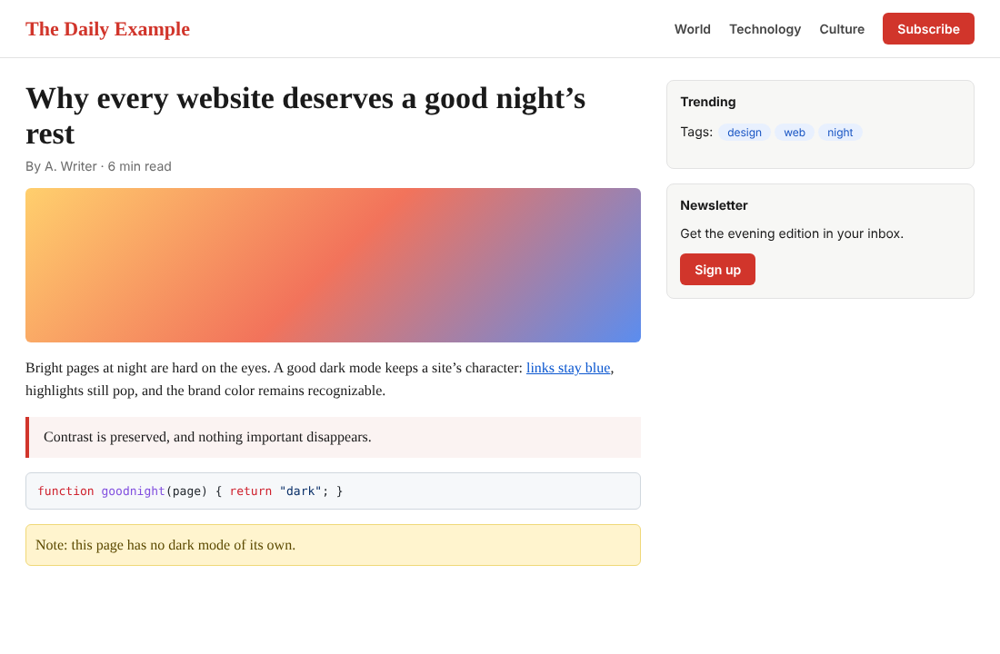
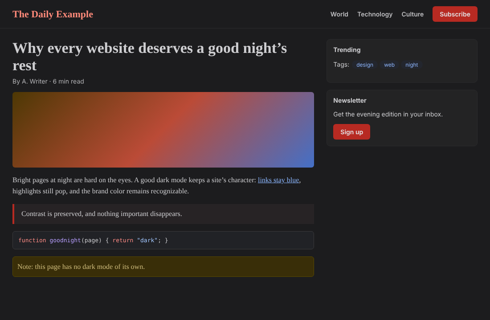
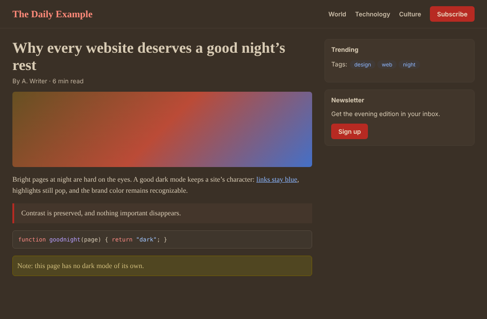
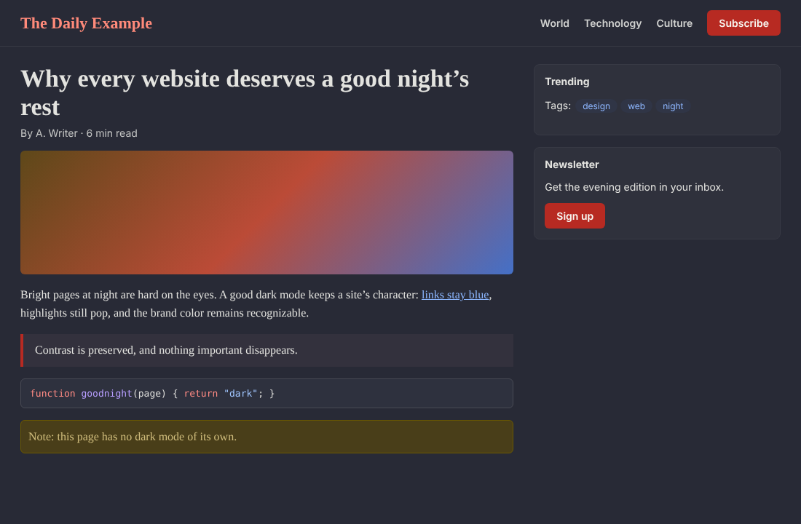
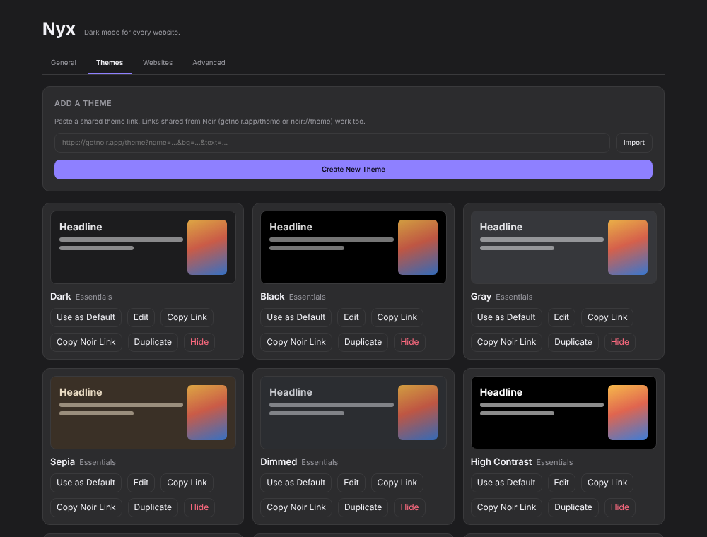

<p align="center"></p>

<h1 align="center">Nyx</h1>

<p align="center"><strong>An open-source dark mode for every website.</strong><br>
A Safari Web Extension for iPhone, iPad and Mac. It also runs in Chrome and Firefox.<br>
It is a clean-room, compatible reimplementation of the feature set of <em>Noir – Dark Mode for Safari</em>.</p>

| Original page | Nyx · Dark | Nyx · Sepia | Nyx · Dracula |
| --- | --- | --- | --- |
|  |  |  |  |

Nyx does not invert pages. It reads each page's own stylesheets and generates a dark
style tailored to that page:

- Links stay blue and brand colors stay recognizable.
- Cards stay distinguishable from the page.
- Text always meets WCAG contrast against the background.

## Features

- **Auto / On / Off.**
  - **Auto** follows the system Dark Mode or a schedule (default 20:00–07:00).
  - **On** always darkens websites.
  - **Off** never darkens websites.
- **Per-website settings**, set from the toolbar menu:
  - status: Default, Auto, On or Off
  - theme
  - **Pause Until Tomorrow**
  - **ignore the website's built-in dark mode**
- **Settings scopes.** Settings can apply to a whole domain, a subdomain, a host with a port (`192.168.1.2:8080`), or a single page.
- **Built-in dark mode detection.** Sites that already have a dark mode are left alone, and Nyx re-checks when a site switches its own theme.
- **26 built-in themes:**
  - Dark, Black, Gray and Sepia
  - six color themes
  - editor themes: Dracula, Nord, One Dark, Solarized, Gruvbox, Catppuccin, Tokyo Night
  - moody themes
- **Custom themes.** Each theme has a background color, text color, image brightness and grayscale.
- **Theme links that work with Noir.** Import links shared from Noir (`https://getnoir.app/theme?…` or `noir://theme?…`), and copy any theme as a Nyx link or a Noir-format link.
- **Advanced appearance options**, set per website: dynamic colors, background images, image inversion.
- **Image handling.** Images are dimmed and desaturated according to the theme. Dark logos and icons on transparent backgrounds are inverted so they stay visible.
- **Keyboard shortcuts:**
  - toggle the current website
  - step it through Auto → On → Off → Default
  - pause it until tomorrow
  - cycle themes
  - set the global status
- **Apple integration** (in `apple/`):
  - iCloud sync across devices
  - Shortcuts actions
  - Focus Filter
  - Control Center control
  - `nyx://theme` links
- **Private.** Nyx collects no data. It makes no network requests of its own; it only re-fetches the stylesheets and images the page itself loads, so their colors can be read.



## Install

### Safari (macOS, iOS, iPadOS)

Build the container app with Xcode. See [apple/README.md](apple/README.md).

### Chrome / Edge / Firefox (for development or daily use)

```bash
npm install
npm run build        # → dist/chrome, dist/firefox, dist/safari
```

- **Chrome:** open `chrome://extensions`, turn on Developer mode, click "Load unpacked" and pick `dist/chrome`.
- **Firefox:** open `about:debugging`, choose "Load Temporary Add-on" and pick `dist/firefox/manifest.json`.

## Development

```bash
npm run typecheck
npm test             # unit tests (Vitest)
npm run test:e2e     # loads the built extension into Chromium and checks real pages (Playwright)
npm run watch        # rebuild on change
node scripts/screenshots.mjs   # regenerate the README screenshots
node scripts/icons.mjs         # re-render icons from assets/*.svg
```

[docs/architecture.md](docs/architecture.md) explains how the engine works.

## How this was reverse engineered

Nyx was rebuilt from Noir's **public, observable behavior**:

- App Store metadata
- the complete public version history
- the theme sharing page's source
- reviews and screenshots
- the developer's public statements

The work followed the evidence-first method of [REA](https://github.com/morluto/rea):

- every claim about Noir is recorded in an [evidence ledger](docs/reverse-engineering/evidence.md)
- every behavior Nyx must reproduce is an [obligation](docs/reverse-engineering/obligations.md) with an owner and a verifying test
- unknowns stay listed instead of being guessed

No Noir code, binaries or assets were used. If you own Noir, [docs/reverse-engineering](docs/reverse-engineering/README.md) explains how to check the compatibility claims against your copy with REA.

## License

MIT. See [LICENSE](LICENSE).

Nyx is an independent project. It is not affiliated with or endorsed by Noir or its developer. "Noir" is mentioned only to describe compatibility.
